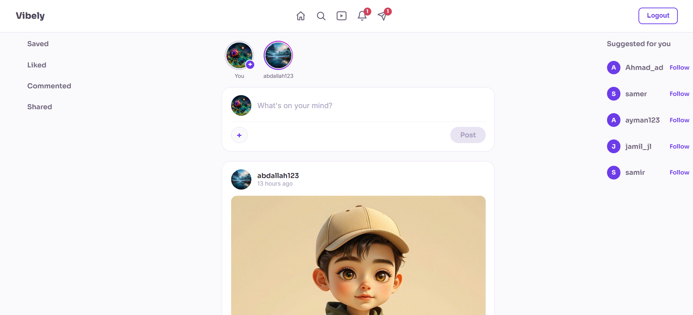
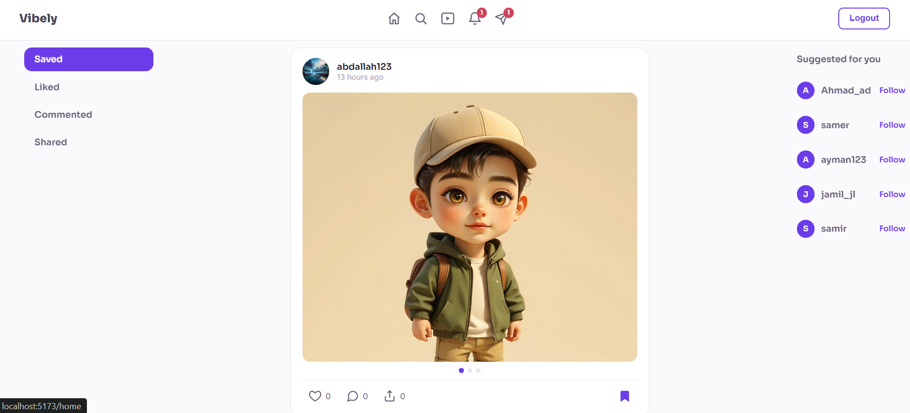
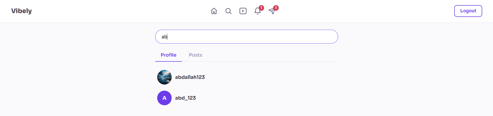
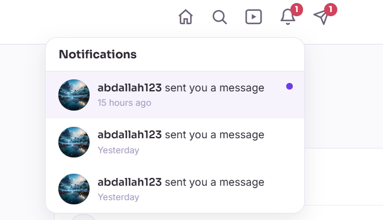
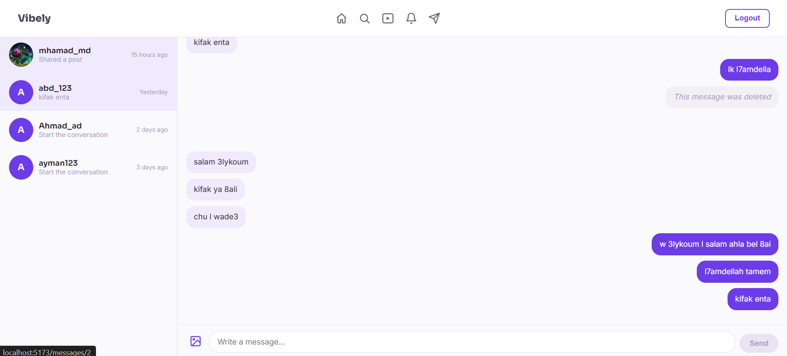

# Vibely

A full-stack social media platform built with Django REST Framework and React — posts, stories, direct messaging, notifications, and short-form video (Reels).


<!-- Add a cover screenshot or GIF here once you have one -->
<!--  -->

## Features

- **Auth** — Token-based registration/login, profile pictures
- **Posts** — Text + multi-image/video posts with an Instagram-style crop tool, infinite scroll feed, edit/delete
- **Interactions** — Like, comment (paginated), Share, Add to Story, Send to Friend (via DM)
- **Follow system** — Follow/unfollow, followers/following lists, mutual-connection suggestions
- **Profiles** — Editable profile picture, tabbed Posts/Shares, active-story indicator
- **Stories** — 24h auto-expiring stories, seen-by list, share-a-post-to-story
- **Messaging** — Real-time-feeling chat (polling), edit/soft-delete messages, shared post previews
- **Search** — Live search across people and posts
- **Notifications** — Likes, comments, follows, shares, story shares, friend shares, and messages — each deep-links to the right place (post, story, comment, or conversation)
- **Reels** — Fullscreen vertical video feed with its own like/comment/share/save actions

## Screenshots

| Home | Saved |
|---|---|
|  |  |

| Search | Reels |
|---|---|
|  |  |

| Notifications | Chats |
|---|---|
|  |  |

## Tech Stack

**Backend:** Django, Django REST Framework, SQLite, Token Authentication, Pillow
**Frontend:** React (Vite), React Router, plain CSS — no UI framework

## Project Structure

```
Vibely/
├── back/                   # Django project
│   ├── config/             # Django settings, root urls.py
│   ├── social/             # Main app: models, views, serializers, urls
│   └── manage.py
└── front/                  # React (Vite) project
    ├── src/
    │   ├── components/     # Reusable UI pieces (PostCard, Navbar, modals, etc.)
    │   ├── context/         # Auth, Follow, Stories context providers
    │   ├── pages/           # Route-level pages (Home, Profile, Messages, Reels, etc.)
    │   └── styles/          # Per-component/page CSS files
    └── index.html
```

## Getting Started

### Prerequisites

- Python 3.10+
- Node.js 18+

### Backend setup

```bash
cd back
python -m venv .venv

# Windows
.venv\Scripts\Activate.ps1
# macOS/Linux
source .venv/bin/activate

pip install -r requirements.txt

python manage.py migrate
python manage.py createsuperuser   # optional, for /admin/
python manage.py runserver
```

The API runs at `http://127.0.0.1:8000/`.

### Frontend setup

Open a **second terminal** (no virtual environment needed here):

```bash
cd front
npm install
npm run dev
```

The app runs at `http://localhost:5173/`.

> Note: the frontend expects the backend at `http://127.0.0.1:8000`. If you change the backend port, update `API_BASE` in the relevant frontend files.

## API Overview

All endpoints are under `/api/` and require a `Token <key>` Authorization header (except `register/` and `login/`).

| Area | Endpoints |
|---|---|
| Auth | `register/`, `login/`, `me/`, `logout/` |
| Posts | `posts/`, `posts/<id>/`, `posts/<id>/like/`, `posts/<id>/save/`, `posts/<id>/comments/`, `posts/<id>/share/`, `posts/<id>/share-to-story/` |
| Profile | `profile/<username>/`, `profile/<username>/posts/`, `profile/<username>/shares/`, `profile/<username>/followers/`, `profile/<username>/following/`, `profile/<username>/story-group/`, `profile/update-picture/` |
| Follow | `users/<username>/follow/`, `users/suggested/` |
| Stories | `stories/`, `stories/<id>/view/`, `stories/<id>/viewers/`, `stories/<id>/detail/` |
| Messaging | `conversations/`, `conversations/start/`, `conversations/<id>/messages/`, `messages/<id>/`, `conversations/unread-count/` |
| Search | `search/users/?q=`, `search/posts/?q=` |
| Notifications | `notifications/`, `notifications/unread-count/`, `notifications/<id>/read/` |
| Reels | `reels/` |

## Design

Vibely's visual identity: purple `#6c3ce9` as the primary accent, a light `#faf9fc` background, Sora for headings + Inter for body text, and white cards with a soft `#e8e4f2` border (no heavy shadows).

## Roadmap

- [ ] Admin panel for content moderation